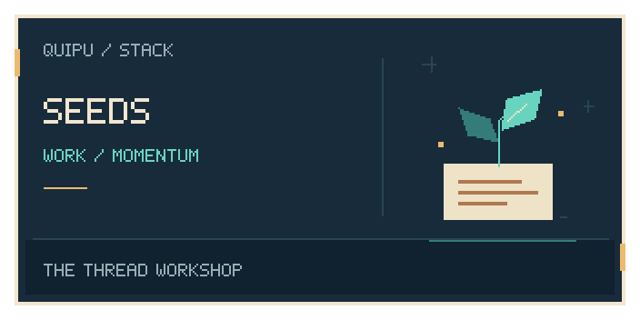

<p align="center"></p>

# seeds

**seeds is a drop-in replacement for [beads](https://github.com/gastownhall/beads):
an issue tracker for AI coding agents that answers the `bd` verbs they already
type (`create`, `show`, `list`, `ready`, `update`, `close`, `dep`, `comments`),
with `--json` in bd's output shape. Install it, import your bd board, keep
typing the same verbs. Underneath, each work item is a set of facts in a
[quipu](https://github.com/scbrown/quipu) knowledge graph rather than rows in a
Dolt database, and that is where seeds does more than beads.** The
name comes from the counting board: a *quipucamayoc* moved seeds across a
*yupana* to count, then knotted the result into the quipu.

<p align="center"></p>

This 20-second recording runs native sd 0.8.0 in a new, isolated local Quipu store. Every command names the public fixture graph and actor; the local fixture configuration sets the demo prefix. It creates one work item, reads the ready queue, then reports counts. No server, sync or production tracker is used. [Reproduce the recording](docs/demos/terminal.md).

## Install

```sh
curl -fsSL https://raw.githubusercontent.com/scbrown/seeds/main/install.sh | sh
```

Python 3.9+, curl, and a Linux or macOS shell. Downloads the latest published archive, verifies SHA-256 and the executable
version before publishing command links in `~/.local/bin`. Add it to `PATH`.
The complete versioned bundle stays in `~/.local/lib/seeds/TAG` for rollback.
Published targets: Linux and macOS, x86_64 and arm64.

Set `STACK_INSTALL_ROOT` on the receiving shell for another prefix.
Pinned releases, alternatives, configuration and removal are in the
[installation and usage reference](docs/installation-reference.md).

## Coming from beads

Export the board with bd, then rehearse and import it. Ids, statuses,
priorities, types, labels, assignees, dependencies, comments, close reasons and
timestamps come across unchanged; every other field is carried and given back
by `sd cutover export`. Measured against bd 1.0.5 (Dolt backend).

```bash
bd export -o issues.jsonl                     # in the bd workspace
G="--store .seeds/seeds.db --graph https://seeds.local/project/myproject"
sd $G cutover verify --file issues.jsonl      # in-memory rehearsal: expect "losses": 0
sd $G cutover import --file issues.jsonl --dry-run
sd $G cutover import --file issues.jsonl      # re-running writes nothing
```

The verbs agents emit from training:

| bd | sd |
|---|---|
| `bd create "T" -p 1 -t task -d D -l a,b -a NAME --parent ID` | same |
| `bd show ID --json` | same |
| `bd list -s open -t task -p 1 -l L --json` | same |
| `bd ready --json` | same |
| `bd update ID --claim` / `--status in_progress` / `--add-label L` | same |
| `bd close ID -r "why"` | same |
| `bd reopen ID -r "why"` | same |
| `bd dep add A B` / `bd dep remove A B` | same |
| `bd comments add ID "text"` | same |
| `bd blocked`, `bd stats`, `bd search Q` | same |

Known differences, following `br` where bd and br disagree: `-a` on `list` is
`--all` (use `--assignee`); no `-n` (use `--limit`) or `ready -u` (use
`--unassigned`); `bd comments ID` is `sd comments list ID`; `bd dep tree` is
`sd graph`; `--as-of` is `--at <tx>`. The full audit, field mapping and what
is not imported are in [Moving from beads](https://intigraph.github.io/seeds/from-beads.html).

## More than beads

- **Work items are facts in a graph.** Query the board with SPARQL next to
  everything else quipu knows, and shapes (SHACL) check every seed
  ([storage model](https://intigraph.github.io/seeds/storage.html)).
- **History per fact, not per database.** Every write is one quipu
  transaction; `sd show ID --at <tx>` reads a seed as it stood then and
  `sd history ID` lists its changes
  ([pinning](https://intigraph.github.io/seeds/pinning.html)).
- **Signed writes and provenance.** `sd key init` signs writes to a quipu
  server so no bearer goes on the wire; each write records its actor
  ([signed writes](https://intigraph.github.io/seeds/config.html#signed-writes-no-bearer-on-the-wire)).
- **Pendants and three-way sync.** Commit the ledger to git as a pendant,
  merge it with a field-level merge driver, or `sd sync` against a shared
  server; conflicts are reported, never resolved by picking a side
  ([storage modes](https://intigraph.github.io/seeds/storage-modes.html)).
- **Links from work to knowledge.** A seed can wait on an external blocker in
  another graph and link to the workflow run that produced it
  ([external blockers](https://intigraph.github.io/seeds/external-blockers.html)).
- **Choose where work lives:** a local file, a committed pendant or a shared
  server, with the same verbs.

## First success in three commands

No server and no configuration: the first write creates a local quipu store at
`.seeds/seeds.db`.

```bash
sd create "Write the parser" -p 1
sd ready --json
echo "exit $?"
```

```text
created ○ sd-k2x [P1] [task] Write the parser (tx 1)
[{"assignee":null, … ,"id":"sd-k2x","issue_type":"task", … ,"priority":1,"revision":1,"status":"open","title":"Write the parser", … }]
exit 0
```

## On your own code

| You want to | Run |
|---|---|
| Read ready work | `sd ready --json` |
| Open an item | `sd create "Write the parser" -p 1 -t task` |
| Claim an item | `sd update <id> --claim` |
| Inspect supported commands and output | `sd capabilities --json` |

[Command reference](https://intigraph.github.io/seeds/reference.html)
covers flags, output and exit codes.

## Wire it into your agent

Give your agent the [command reference](https://intigraph.github.io/seeds/reference.html)
and run `sd capabilities --json` to inspect the installed command contract.
Choose the intended store and graph explicitly when working across projects.
An alias from another tracker is a separate Desire Path configuration; review
existing aliases before changing them.

## Before you start

The shell installer needs Python 3.9+, curl and Linux or macOS. A local store
needs no server; its first write creates `.seeds/seeds.db`. Run the example in
a disposable directory if you do not want a project ledger there. Shared stores
require endpoint and graph configuration; see [storage modes](https://intigraph.github.io/seeds/storage-modes.html).

## What's next

- [The Seeds book](https://intigraph.github.io/seeds/): concepts and usage.
- [Installation reference](docs/installation-reference.md): configuration and removal.
- [Reproduce the terminal demo](docs/demos/terminal.md): local fixture and full output.

### Related tools and repository knowledge

- [Tambo](https://github.com/scbrown/tambo): guided stack installation and verification.
- [Camayoc](https://github.com/scbrown/camayoc): governed memory and vocabulary.
- [Detailed examples and agent setup](docs/installation-reference.md).

**Load this repository’s graph:** public repository-pendant assets have not yet been verified. When a release supplies the archive, checksum and provenance, follow the [verified import workflow](https://intigraph.github.io/quipu/sharing/index.html): extract the share directory and use `quipu import SHARE_DIR --db repository.db`. Import stages knowledge; ROOT stays unchanged.

## 🧺 The stack

<!-- stack-table:start -->

The Quipu stack is built around a governed, bitemporal knowledge store: shared
facts, decisions and work history your agents can query. Quipu can check writes
against your rules, records where each fact came from, and answers what was true
when.

| tool | what it gives your agents |
|---|---|
| [tambo](https://github.com/intigraph/tambo) | 🧰 Agent Platform Toolkit - installs and configures the quipu stack |
| [quipu](https://github.com/intigraph/quipu) | stores shared facts with provenance and history; can check writes against your rules |
| [camayoc](https://github.com/intigraph/camayoc) | prepares knowledge and vocabulary for Quipu, with checks before it is admitted |
| [quechua](https://github.com/intigraph/quechua) | shared vocabulary and shapes for interoperable knowledge |
| [chaski](https://github.com/intigraph/chaski) | reacts to graph changes and delivers governed notifications |
| [bobbin](https://github.com/intigraph/bobbin) | indexes your codebase and injects context from that index and Quipu knowledge |
| [yupana](https://github.com/intigraph/yupana) | shows code impact and can read policies from Quipu to govern agent actions |
| [desire-path](https://github.com/intigraph/desire-path) | turns agent mistakes into feature requests; works on its own without Quipu |
| [seeds](https://github.com/intigraph/seeds) | a work item tracker backed by the Quipu knowledge base |
| [shantytown](https://github.com/intigraph/shantytown) | runs crews of AI agents on work items, triggered by hand, on a schedule or by events; can share work and memory through Quipu |
| [rikuy](https://github.com/intigraph/rikuy) | live brief: status, graphs, watches and signed decisions over Quipu |
| [shuttle](https://github.com/intigraph/shuttle) | runs signed agent workflows and keeps their records in Quipu |

<!-- stack-table:end -->


## Contributing

Run `just check` and `just test` before submitting a change.

## 📜 License

[License](LICENSE).
